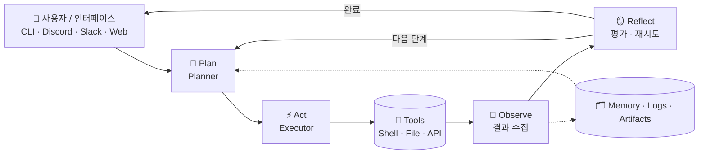
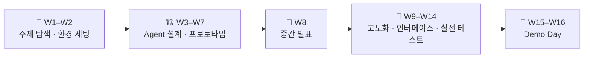

<h1 align="center">나만의 AI Agent 만들기</h1>
<p align="center"><b>MyPersonalAgent</b></p>

<div align="center">
<a href="https://pseudo-lab.com"></a>
<a href="https://discord.gg/EPurkHVtp2"></a>
<a href="https://github.com/Pseudo-Lab/MyPersonalAgent/stargazers"></a>
<a href="https://github.com/Pseudo-Lab/MyPersonalAgent/network/members"></a>
<a href="https://github.com/Pseudo-Lab/MyPersonalAgent/pulls"></a>
<a href="https://github.com/Pseudo-Lab/MyPersonalAgent/issues"></a>
<a href="https://github.com/Pseudo-Lab/MyPersonalAgent/graphs/contributors"></a>
</div>
<br>

> 쓰기만 하던 AI Agent, 이제 직접 만들어 봅시다! 🤖
> Plan–Act–Observe–Reflect 구조를 이해하고, 파일 처리·API 호출 같은 **실제 작업을 자동으로 수행하는 나만의 Agent**를 16주 동안 함께 만듭니다.

## 🌟 프로젝트 개요 (Project Overview)

ChatGPT, Claude 같은 AI 서비스는 이제 일상이 되었지만, 그 안에서 Agent가 어떻게 계획하고, 도구를 실행하고, 결과를 관찰하고, 스스로 되돌아보는지 직접 만들어 본 사람은 많지 않습니다.
이 프로젝트에서는 각자 **자동화하고 싶은 주제**를 정하고, Tool 실행 · Workflow · Memory · 안전 설계를 갖춘 **실행 가능한 자동화 Agent**를 처음부터 구현합니다. 중간 발표와 최종 Demo Day에서 각자의 Agent를 시연합니다.

| 항목 | 내용 |
|------|------|
| 🗓️ 기간 | 16주 (가짜연구소 13기 시즌 프로젝트) |
| ⏰ 정기 모임 | 매주 토요일 22:00 ~ 23:00 |
| 📍 장소 | Discord `Room-GH` |
| 👥 인원 | Builder 1명 + Runner 9명 |
| 🧰 활용 AI 서비스 | ChatGPT, Claude |

<br>
<h3 align="center">
  <p>🛠️ 남이 만든 Agent만 쓰지 말고, 내 일을 대신할 Agent를 만들자! 🛠️</p>
</h3>
<br>

## 🎯 프로젝트 목표 (Project Vision)

- 🧠 **Agent 구조 이해와 구현**
  - Plan → Act → Observe → Reflect 루프를 이해하고 직접 구현
- 🔧 **실행 가능한 자동화 시스템 구축**
  - Tool 실행 (Shell, File, API)
  - Task Planning & Workflow
  - Memory & Logging
  - 안전 설계 (재시도, 예외 처리)
- ⚙️ **실제 작업 자동화**
  - 파일 처리, API 호출 등 현실의 작업을 자동으로 수행하는 Agent
- 🎤 **시연과 공유**
  - 중간 발표(W8)와 최종 Demo Day(W16)에서 Agent 시연

### Agent 아키텍처



### 📦 결과물 (Deliverables)

- ✅ 실행 가능한 자동화 Agent 코드
- ✅ Tool 실행 및 Workflow 구조를 갖춘 Agent 시스템
- ✅ 실행 로그와 Memory를 포함한 아키텍처
- ✅ README 및 설계 문서
- ✅ 시연 영상 또는 Demo 발표 자료

## 🧑 팀 소개 (Team)

| 이름 | 역할 | 관심 영역 / 자동화 주제 |
|------|------|------------------------|
| 김건호 | Builder (프로젝트 리더) | - |
| 한승헌 | Runner | - |
| 지민석 | Runner | - |
| Chaiwon Hwang | Runner | - |
| 김은희 | Runner | - |
| 황예은 | Runner | - |
| 김현규 | Runner | - |
| 정승제 | Runner | - |
| Juyeong Park | Runner | - |
| 최의관 | Runner | - |

## 🚀 프로젝트 로드맵 (Project Roadmap)



## 📅 주차별 활동 (Activity History)

| 주차 | 내용 | 비고 |
|------|------|------|
| W1 | OT, 자기소개, 자동화 주제 아이디어 탐색 | |
| W2 | 주제 발표 및 실현 가능성 검토, 개발 환경 소개 | |
| W3 | Agent 기본 구조 이해, 아키텍처 초안 설계 | |
| W4 | Tool 구조(Shell, File, API) 설계 및 기본 실행 기능 구현 | |
| W5 | Task Planning 구조 설계, 간단한 워크플로우 구현 | |
| W6 | 기본 Agent 프로토타입 완성 및 시나리오 적용 | |
| W7 | 로그, Memory, Workflow 구조 개선 | |
| W8 | 🎤 **중간 발표 (Midterm)** | 전원 |
| W9 | 피드백 반영, 리팩토링 및 기능 확장 | |
| W10 | Planner–Executor 구조, 재시도 로직 등 안정성 강화 | |
| W11 | Memory, Logging, Artifact 관리 체계화 | |
| W12 | Discord, Slack, Web UI, CLI 인터페이스 구현 | |
| W13 | 실제 환경 테스트, 성능 개선, 예외 처리 | |
| W14 | 실제 환경 테스트 및 완성도 향상 | |
| W15 | Demo 준비: 기능·코드 정리, 문서화, 발표 준비 | |
| W16 | 🏁 **Demo Day** 및 프로젝트 마무리 | 전원 |

> 🎉 **13th PseudoCon**에서 프로젝트 후기를 함께 나눌 예정입니다.

## 🛠️ 우리의 개발 문화 (Our Development Culture)

```python
class MyPersonalAgentStudy:
    def __init__(self):
        self.tools = {
            "communication": "Discord (Room-GH)",
            "version_control": "GitHub",
            "ai_assistants": ["ChatGPT", "Claude"],
            "docs": "README & 설계 문서",
        }

    def weekly_loop(self):
        return """주간 사이클 (Plan → Act → Observe → Reflect):
        1️⃣ Plan    : 이번 주 구현 목표 공유
        2️⃣ Act     : 각자 Agent 기능 구현
        3️⃣ Observe : 토요일 22시 정기 모임에서 진행 상황 시연
        4️⃣ Reflect : 피드백을 다음 주 계획에 반영"""
```

## 📈 성과 지표 (Achievement Metrics)

| 지표 | 목표치 | 현재 달성률 |
|------|--------|-------------|
| 동작하는 개인 Agent | 1인 1 Agent | 0% |
| 중간 발표 시연 | 전원 | 0% |
| Demo Day 시연 | 전원 | 0% |
| README · 설계 문서 | 1인 1 문서 | 0% |

## 🌱 참여 안내 (How to Engage)

**팀원(Runner) 모집은 마감되었습니다.** 다음 시즌 러너 모집 기간에 신청해 주세요.

**참여 조건 및 우대 사항**
- 적어도 하나의 AI Agent를 구독 중이거나 구독 의향이 있을 것
- 목표 달성을 위해 열의를 갖고 노력할 것
- AI Agent 기본 사용법을 알면 좋음 (필수 아님)
- 우대 재능: 툴 관리, 문서 정리, 친화력

**누구나 청강을 통해 모임에 참여하실 수 있습니다.**
1. 특별한 신청 없이 정기 모임 시간(매주 토요일 22:00)에 맞춰 [Discord](https://discord.gg/EPurkHVtp2) `#Room-GH` 채널로 입장
2. 중간 발표 · Demo Day 참관
3. 가짜연구소 행사(PseudoCon)에서 만나기

## Acknowledgement 🙏

MyPersonalAgent is developed as part of Pseudo-Lab's Open Research Initiative. Special thanks to our contributors and the open source community for their valuable insights and contributions.

## About Pseudo Lab 👋🏼

[Pseudo-Lab](https://pseudo-lab.com/) is a non-profit organization focused on advancing machine learning and AI technologies. Our core values of Sharing, Motivation, and Collaborative Joy drive us to create impactful open-source projects. With over 5k+ researchers, we are committed to advancing machine learning and AI technologies.

<h2>Contributors 😃</h2>
<a href="https://github.com/Pseudo-Lab/MyPersonalAgent/graphs/contributors">
  
</a>
<br><br>

## License 🗞

This project is licensed under the [MIT License](https://opensource.org/licenses/MIT).
